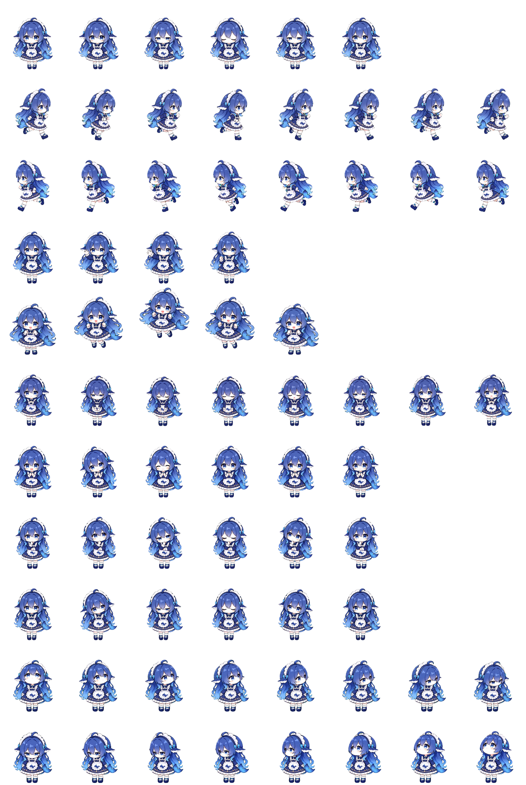
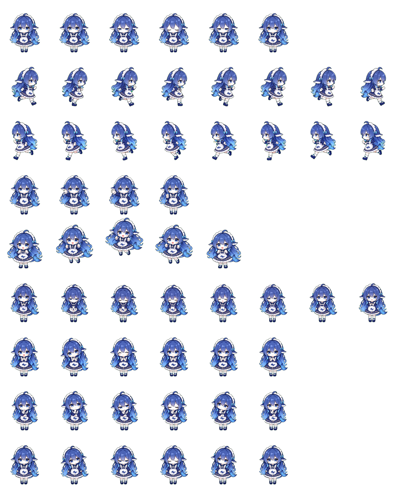

# 大肥鱼 | Da Fei Yu — 2D Animated Pet Sprites

> 蓝发蓝眼、鲸鱼围裙的 Q 版角色动画素材集。包含透明 PNG 精灵图集、独立动画帧及验证元数据，可用于桌面宠物、互动助手和 2D UI 原型。



## 项目简介

本仓库公开的是 **角色动画资源包**，并非可独立运行的桌面宠物应用。角色设计参考 [Cayhaze/deepseek-pet](https://github.com/Cayhaze/deepseek-pet)。使用及二次分发前请核对上游资源与衍生素材的授权条件；本仓库不擅自声明原角色素材的版权归属。

## 资源规格

- 扩展版 Sprite Sheet：`final/spritesheet-extended.png`
- 画布尺寸：**1536 × 2288 px**；**8 列 × 11 行**
- 单帧尺寸：**192 × 208 px**；PNG RGBA 透明背景
- 独立帧：`final-frames/<state>/<index>.png`
- 验证报告：`final/validation-extended.json`（原始记录 `ok: true`）



## 动画状态与帧数

| 状态 | 图集行（从 0 开始） | 帧数 | 用途 |
|---|---:|---:|---|
| `idle` | 0 | 6 | calm resting, breathing, and blinking loop |
| `running-right` | 1 | 8 | rightward drag movement loop |
| `running-left` | 2 | 8 | leftward drag movement loop |
| `waving` | 3 | 4 | greeting or attention gesture |
| `jumping` | 4 | 5 | hover or playful jump |
| `failed` | 5 | 8 | blocked, failed, or cancelled reaction |
| `waiting` | 6 | 6 | waiting for approval, help, or user input |
| `running` | 7 | 6 | active task work or processing |
| `review` | 8 | 6 | ready or completed output review |
| `look-row-9` | 9 | 8 | clockwise look directions from up through down-right |
| `look-row-10` | 10 | 8 | clockwise look directions from down through up-left |

## 动画与坐标算法（参考实现）

以下公式用于将本素材集成到游戏引擎或桌面应用中，**不代表素材包已附带这些算法的运行代码**。

### 1. 精灵图集裁切

第 `r` 行、第 `c` 列的帧对应裁切矩形：

$$
(x,y,w,h)=(192c,\ 208r,\ 192,\ 208)
$$

其中 `0 ≤ c < 8`、`0 ≤ r < 11`。仅使用各状态实际定义的有效帧，不能把空单元格当成动画帧。

### 2. 动画帧循环

设动画播放速度为 `f` FPS、状态帧数为 `N`，在经过 `t` 秒后：

$$
 k(t)=\lfloor tf\rfloor\bmod N
$$

示例：空闲状态 `N=6`，若设定 `f=8` FPS，则完整循环时长：

$$
 T=\frac{N}{f}=\frac{6}{8}=0.75\text{ s}
$$

**8 FPS 为演示参数，不是素材包记录的固定播放速度。**

### 3. 面向目标的方向角

角色坐标为 `(x_p,y_p)`，目标位置为 `(x_t,y_t)`：

$$
\theta=\operatorname{atan2}(y_t-y_p,\ x_t-x_p)
$$

当使用离散朝向帧时，可以将角度量化到最近的方向索引：

$$
 d=\operatorname{round}\left(\frac{M\theta}{2\pi}\right)\bmod M
$$

其中 `M` 是可用方向数量。实际朝向索引与图集列的对应关系，应根据 `pet_request.json` 的方向定义映射，不能直接假定 0° 对应某一固定列。

### 4. 角色平滑移动

给定目标位置 `\mathbf p_{target}`、当前坐标 `\mathbf p_t` 和每帧间隔 `\Delta t`，可采用指数逼近：

$$
\mathbf p_{t+1}=\mathbf p_t+(1-e^{-\lambda\Delta t})(\mathbf p_{target}-\mathbf p_t)
$$

其中 `λ > 0` 控制跟随速度。这是可选的交互动画方法，不属于素材生成流程的已验证功能。

## 快速使用

1. 在游戏引擎或应用中加载 `final/spritesheet-extended.png`。
2. 设置单帧尺寸为 `192 × 208`，按行选择动画状态。
3. 根据上方状态表读取对应帧数，避免读取空白单元格。
4. 按需要播放 `final-frames/` 中的单独 PNG 帧。
5. 将鼠标跟随、状态切换、交互触发等逻辑接入你的运行环境。

## 目录结构

```text
.
├── README.md
├── final/
│   ├── spritesheet-extended.png
│   ├── spritesheet.png
│   └── validation-extended.json
├── final-frames/
│   ├── idle/
│   ├── running-left/
│   ├── running-right/
│   └── ...
├── pet_request.json
├── pet-record.json
└── frames/
    └── frames-manifest.json
```

## 说明

本项目提供动画资源与数据说明，不包含原项目运行程序。`pet-record.json` 内的激活记录只反映素材生成时的状态，并不表示下载本仓库后会自动安装或激活宠物。元数据中可能保留生成环境路径与本地标识，仅用于追溯，不应作为跨设备绝对路径使用。

## 致谢与授权

角色参考来源：[Cayhaze/deepseek-pet](https://github.com/Cayhaze/deepseek-pet)。请在公开分发前核实角色参考图、衍生图片及其他素材的实际授权范围。此处暂不添加 LICENSE，以免错误授予不属于自己的素材权利。
